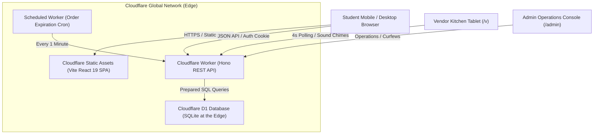
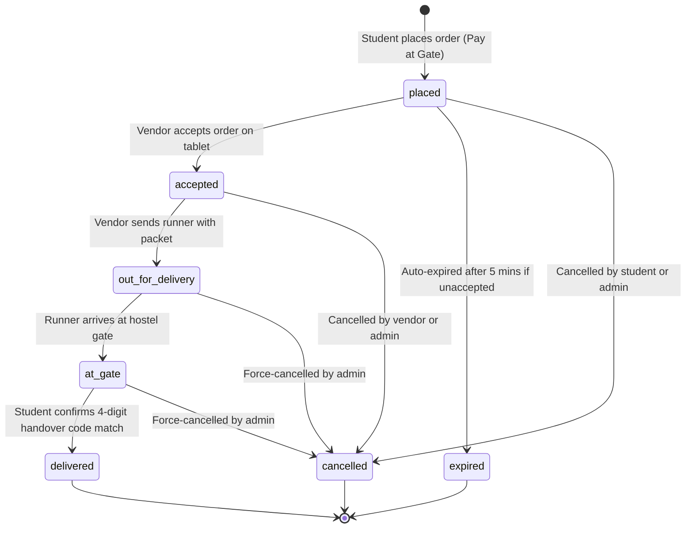
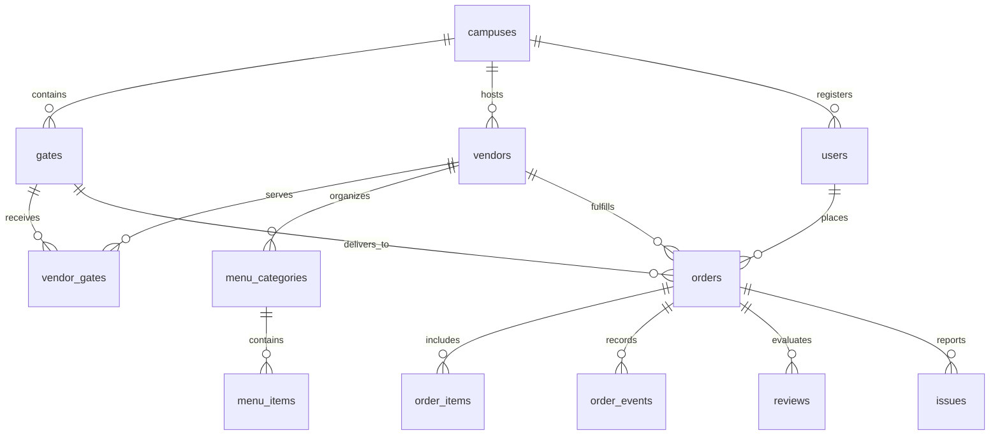

# TreFood Architecture Specification

TreFood is a hyperlocal campus food and essentials delivery platform tailored specifically for the National Institute of Technology Patna (NIT Patna). The system optimizes for extreme speed, transparent hostel gate handover verification, zero delivery fees, and strict curfew awareness.

---

## 1. System Overview

TreFood is built as a single Cloudflare Worker application utilizing Cloudflare Static Assets. A single worker serves both the React Single Page Application (SPA) and all `/api/*` endpoints with zero cold starts and sub-50ms latency across India.

---

## 2. Order Lifecycle State Machine

Orders progress strictly forward through verified state transitions. State transitions are computed exclusively on the server (`src/worker/services/order.ts`) and append an immutable event row in `order_events`.

### Transition Permissions Matrix

| Transition | Allowed Actors | Verification Requirement |
| :--- | :--- | :--- |
| `placed` → `accepted` | Vendor, Admin | Order in `placed` status |
| `accepted` → `out_for_delivery` | Vendor, Admin | Order in `accepted` status |
| `out_for_delivery` → `at_gate` | Vendor, Admin | Runner arrives at hostel gate |
| `at_gate` → `delivered` | Student (Customer) | **Customer ownership check**; order must be at gate |
| `placed` → `expired` | Cron System | Created > 5 minutes ago |
| Any active → `cancelled` | Admin, Student (`placed` only) | Valid cancellation reason required |

---

## 3. Core Database Entities (Cloudflare D1)

The database schema is defined with Drizzle ORM in `src/worker/db/schema.ts` with strict relational constraints:

### Key Schema Design Decisions
1. **Integer Paise Currency**: All monetary fields (`price_paise`, `subtotal_paise`, `total_paise`, `delivery_fee_paise`) are stored as unsigned 64-bit integers. Float calculations are prohibited.
2. **Text ULID Identifiers**: Primary keys are Universally Unique Lexicographically Sortable Identifiers (ULIDs), ensuring chronological sortability and eliminating auto-increment enumeration leaks.
3. **UTC Timestamps**: Timestamps are stored as UTC Unix epoch seconds. All curfew and operating hour rules are converted dynamically to `Asia/Kolkata` (UTC+05:30).
4. **Active Order Code Uniqueness**: A partial unique index on `(gate_id, handover_code)` ensures that no two active orders at the same hostel gate share the same 4-digit verification code.

---

## 4. Curfew & Delivery Feasibility Logic

Delivery availability is enforced by the pure service `canDeliver` (`src/worker/services/delivery.ts`):

$$\text{Estimated Arrival} = \text{Current Time (IST)} + \text{Prep Time} + \text{Travel Time} + \text{Buffer Time}$$

If $\text{Estimated Arrival} > \text{Gate Curfew Time}$, delivery is rejected with error code `too_late`. The service evaluates other gates on campus and returns alternative gates where curfew has not passed.

---

## 5. Security & Privacy Architecture

- **Stateless Zero-Trust Middleware**: Every request checks user roles (`student`, `vendor`, `admin`) in server middleware (`src/worker/middleware.ts`). Client state is never trusted.
- **Constant-Time Cryptography**: Passwords, OTP peppers, and secret hashes are evaluated using WebCrypto `crypto.subtle.timingSafeEqual` to eliminate side-channel timing leaks.
- **Session Security**: Session tokens are 256-bit cryptographically random strings; only their SHA-256 hash is stored in D1. Production uses `__Host-` prefixed cookies with `HttpOnly`, `Secure`, and `SameSite=Lax`.
- **Right to Erasure (GDPR)**: `DELETE /api/auth/delete-account` completely purges active sessions, clears student credentials, and anonymizes historical order references.
